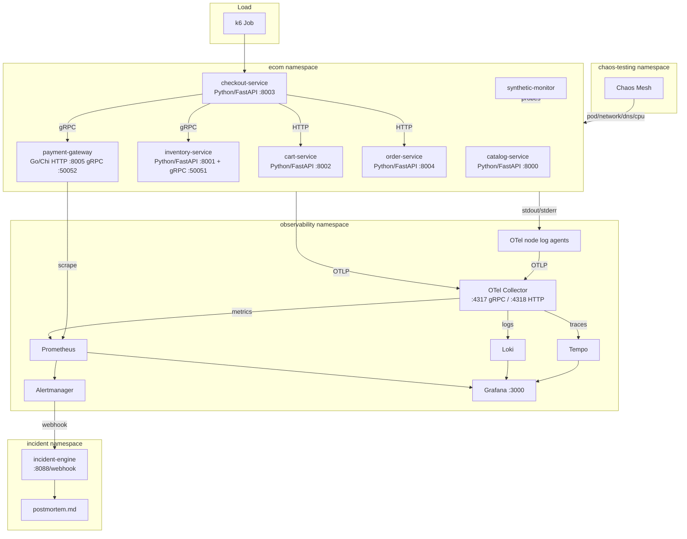

# flow-qs: Distributed Observability Platform

[](https://github.com/Meillaya/enten-v2/actions/workflows/lint.yaml)
[](https://github.com/Meillaya/enten-v2/actions/workflows/test.yaml)
[](https://github.com/Meillaya/enten-v2/actions/workflows/build-images.yaml)

A Kubernetes-deployed observability and incident-response platform built around a small polyglot e-commerce app. Every service is instrumented with OpenTelemetry; an OTLP Collector fans traces to Tempo, logs to Loki, and metrics to Prometheus. Grafana ties the three signals together, Prometheus multi-window burn-rate alerts flow through Alertmanager to a tiny incident engine, and that engine assembles a timeline and writes a Markdown postmortem.

**Resume bullet**: Built a Kubernetes-deployed distributed observability platform using OpenTelemetry, Prometheus, Grafana, Loki, and Tempo to collect traces, logs, and metrics, detect SLO violations, run chaos experiments, and generate automated incident reports.

## Architecture



## Stack

| Layer | Technology | Purpose |
|-------|------------|---------|
| Cluster | k3d + Terraform | Local Kubernetes, reproducible |
| Services | Python/FastAPI + Go/Chi | Polyglot microservices with OTel auto-instrumentation |
| Telemetry | OpenTelemetry Collector | One OTLP gateway plus per-node log agents |
| Traces | Grafana Tempo | Distributed trace storage and query |
| Logs | Grafana Loki | Log aggregation |
| Metrics | Prometheus | Time-series metrics and SLO recording rules |
| Alerting | Alertmanager | Routes alerts to the incident engine |
| Dashboards | Grafana | Provisioned RED, SLO, trace, and log dashboards |
| Chaos | Chaos Mesh | Pod, network, DNS, and CPU fault injection |
| Load | k6 | Smoke, load, stress, and spike profiles |
| Dev env | devenv | Reproducible shell: Python 3.12, Go 1.26.5, k6, Terraform, kubectl, Helm |

## Quick Start

```bash
devenv shell    # reproducible dev shell
make up         # provision k3d cluster, observability stack, services
make verify     # sanity-check telemetry, SLO rules, dashboards, service health
make demo       # end-to-end: load -> chaos -> incident -> postmortem
```

The stack stays inside the cluster. Open separate terminals for the local demo endpoints — there is no Ingress or permanent host exposure:

```bash
kubectl -n observability port-forward svc/grafana 3000:80
kubectl -n observability port-forward svc/prometheus 9090:80
kubectl -n observability port-forward svc/alertmanager 9093:9093
```

| Service | URL | Credentials |
|---------|-----|-------------|
| Grafana | http://localhost:3000 | `admin / admin` (local demo only) |
| Prometheus | http://localhost:9090 | none |
| Alertmanager | http://localhost:9093 | none |

## Documentation

- [docs/ARCHITECTURE.md](docs/ARCHITECTURE.md) — system diagram, services, telemetry and alert flows, SLO strategy
- [docs/RUNBOOK.md](docs/RUNBOOK.md) — common operations, recovery, cookbooks
- [docs/DEMO.md](docs/DEMO.md) — what `make demo` does and how to read the artifacts
- [docs/SETUP.md](docs/SETUP.md) — full setup instructions and prerequisites
- [docs/examples/postmortems/](docs/examples/postmortems/) — annotated template and illustrative postmortems

## Repository Layout

```text
.
├── Makefile                    # up, down, demo, lint, test
├── devenv.nix / devenv.yaml    # Reproducible dev shell
├── infra/                      # Terraform k3d cluster + OTel/Tempo/Loki/Prom/Grafana configs
├── services/                   # Six product services + synthetic monitor + incident engine
├── charts/                     # Per-service Helm charts
├── dashboards/                 # Provisioned Grafana dashboards
├── observability/              # Prometheus rules and Alertmanager templates
├── slo/                        # SLO definitions
├── chaos/                      # Chaos Mesh experiments
├── load/                       # k6 scripts and Kubernetes Jobs
├── scripts/                    # Validation and build helpers
└── docs/                       # README, ARCHITECTURE, RUNBOOK, DEMO, SETUP
```

## Development Commands

```bash
make lint        # Helm lint, Ruff, ty, gofmt, go vet, golangci-lint
make test        # pytest + go test
make lint-chart  # Helm lint every local chart
make verify      # validate live telemetry, rules, dashboards, and services
make down        # remove only this repository's runtime resources
make clean       # make down + remove Terraform/devenv local state
```

## Lessons Learned

- Keep the gateway and node-agent Collector pipelines in Helm values as the single source of truth for what runs in the cluster.
- Run one node log agent per schedulable node; keep stateful servicegraph processing on the single local-demo gateway.
- `http_server_request_duration_seconds_{bucket,count,sum}` keyed on `service_name`, `service_namespace`, `http_response_status_code`, and `http_route` is the stable RED contract. Payment reaches it through a bounded Prometheus scrape exception.
- Provision Grafana dashboards as JSON and Alertmanager config as YAML so the stack is reproducible without click-ops.
- Multi-window multi-burn-rate alerts cut noise: fast-burn pages catch emergencies, slow-burn warnings catch budget drift.
- Running k6 as a Kubernetes Job keeps load generation inside the cluster network and avoids host-side port conflicts.
- An Alertmanager-to-incident-engine webhook is enough for demo-grade automated postmortems; no UI needed.
- Treat the k6 Job exit, incident correlation, and bounded cleanup as authoritative. The demo fails rather than fabricate a postmortem or weaken thresholds.
- Deploy immutable run-specific image tags so re-running `make up` rolls new pod templates and leaves a Kubernetes rollback target.
- Build every service from digest-pinned base/tool images and committed frozen dependency locks.
