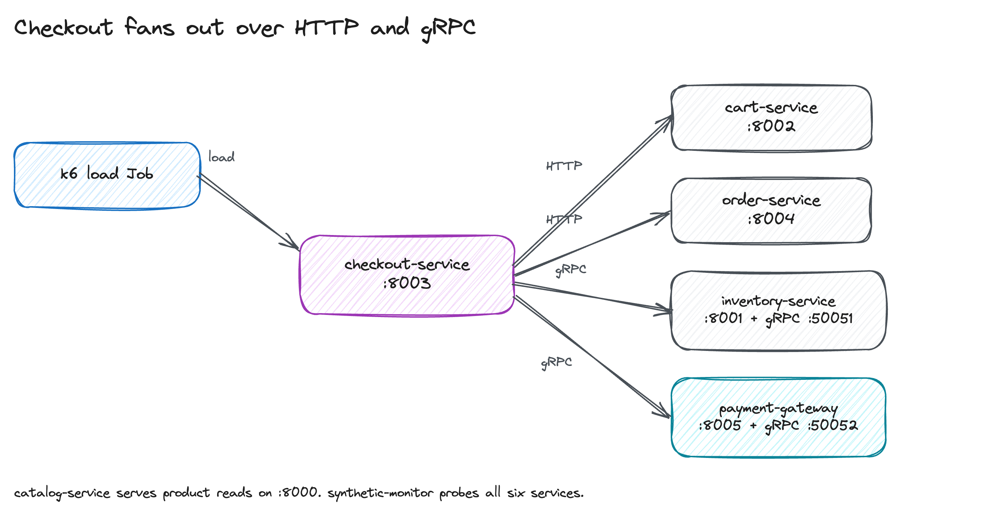
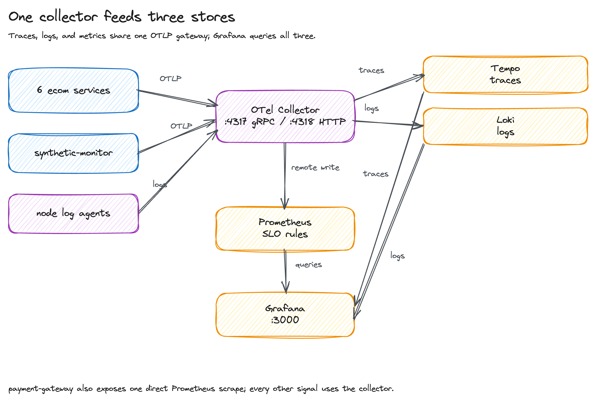
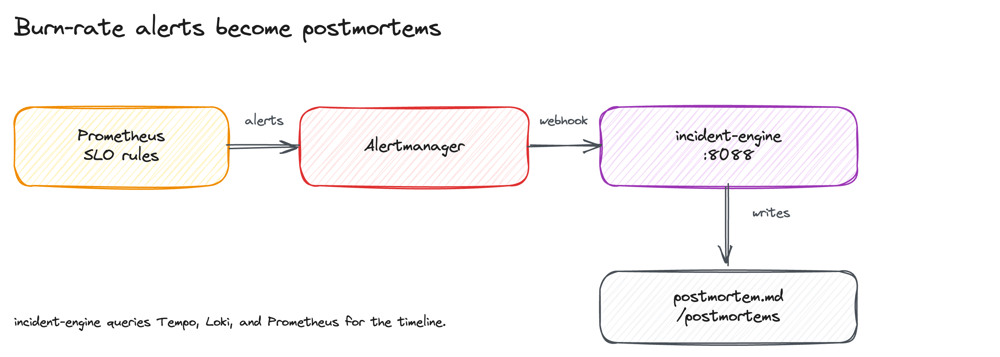

# flow-qs: distributed observability platform

[](https://github.com/Meillaya/flow-qs/actions/workflows/lint.yaml)
[](https://github.com/Meillaya/flow-qs/actions/workflows/test.yaml)
[](https://github.com/Meillaya/flow-qs/actions/workflows/build-images.yaml)

flow-qs runs a small polyglot e-commerce app on a local k3d cluster, then
breaks it on purpose and checks that the alert, trace, log, and postmortem all
describe the same incident. It is for platform engineers and SREs who want a
cluster they can tear down and rebuild while learning the telemetry path.

Eight services run in the cluster. Seven are Python and FastAPI, and one is Go
and Chi. OpenTelemetry collector nodes fan traces to Tempo, logs to Loki, and
metrics to Prometheus. Grafana queries all three, and multi-window burn-rate
alerts reach an incident engine that writes a Markdown postmortem.

The first command:

```bash
devenv shell
```

## Quick start

Prerequisites are Docker 24 or newer with at least 6 GiB assigned, Nix 2.18 or
newer, the devenv CLI, and internet access for the first chart and image pull.

```bash
devenv shell
make test     # 159 Python tests and the Go suite, no cluster needed
make up       # create the cluster, build images, deploy the stack
make verify   # run the 11 live checks
make demo     # drive load and chaos until a postmortem appears
```

`make test` is the shortest check that the code is sound. It runs without
Docker or a cluster.

`make up` builds images from the current commit. Commit service changes before
running it, or the build refuses to start.

`make verify` exits 0 only when all 11 checks pass. `make demo` exits 0 only
when the k6 thresholds pass, the checkout alert fires, and the postmortem names
the same Chaos Mesh experiment. A failed demo cleans up after itself and exits
nonzero.

## Architecture

### Request path



Checkout is the only orchestrator. It reads the cart over HTTP, reserves stock
over gRPC, charges over gRPC, and writes the order over HTTP. catalog-service
serves product reads and is not on the checkout path.

### Telemetry path



Application services export OTLP to one collector, which fans traces to Tempo,
logs to Loki, and metrics to Prometheus. Grafana queries all three. Payment is
the one bounded exception and exposes a direct Prometheus scrape.

### Incident path



Prometheus burn-rate rules send alerts through Alertmanager to incident-engine.
The engine queries Tempo, Loki, and Prometheus, then writes a Markdown
postmortem.

[ARCHITECTURE.md](docs/ARCHITECTURE.md) explains the services, signal schemas,
SLO rules, and failure paths.

## Stack

| Layer | Technology | Role |
|---|---|---|
| Cluster | k3d 5.9 and Terraform | One server, two agents, and a local registry |
| Services | Python 3.12 and Go 1.26 | Seven FastAPI services and one Chi service |
| Telemetry | OpenTelemetry Collector | One OTLP gateway plus one log agent per node |
| Traces | Grafana Tempo | Trace storage with 7 day retention |
| Logs | Grafana Loki | Log storage with 7 day retention |
| Metrics | Prometheus | 31 day retention, SLO recording and alert rules |
| Alerting | Alertmanager | Grouping, inhibition, and the incident engine webhook |
| Dashboards | Grafana | Ten provisioned RED, trace, log, and SLO dashboards |
| Incident response | incident-engine | Queries Tempo, Loki, and Prometheus, then writes a postmortem |
| Chaos | Chaos Mesh | Pod, network, DNS, and CPU faults |
| Load | k6 | Smoke, load, stress, spike, and chaos-aware demo profiles |
| Dev env | devenv | Python, Go, k3d, Terraform, kubectl, Helm, k6, and linters |

## Local access

Every platform Service is `ClusterIP`. Open one forward per surface you need
and stop it with Ctrl+C when finished.

```bash
kubectl -n observability port-forward svc/grafana 3000:80
kubectl -n observability port-forward svc/prometheus 9090:80
kubectl -n observability port-forward svc/alertmanager 9093:9093
```

| Surface | URL | Credentials |
|---|---|---|
| Grafana | http://127.0.0.1:3000 | `admin` / `admin`, local demo only |
| Prometheus | http://127.0.0.1:9090 | none |
| Alertmanager | http://127.0.0.1:9093 | none |

The URLs do not work until the matching forward is running. There is no
Ingress, TLS, or permanent host exposure.

## Documentation

- [docs/SETUP.md](docs/SETUP.md): tool pins, provisioning, access, and the full
  verification contract.
- [docs/ARCHITECTURE.md](docs/ARCHITECTURE.md): services, protocols, telemetry
  and alert flows, and SLO strategy.
- [docs/RUNBOOK.md](docs/RUNBOOK.md): response playbooks and cookbooks for
  adding a service, SLO, or chaos experiment.
- [docs/DEMO.md](docs/DEMO.md): what `make demo` does, the thresholds, and the
  artifacts it leaves behind.
- [docs/DRAWINGS.md](docs/DRAWINGS.md): regenerate and inspect the architecture
  figures.
- [docs/examples/postmortems/](docs/examples/postmortems/): a template, a
  historical example, and postmortems captured from demo runs.
- [CONTRIBUTING.md](CONTRIBUTING.md): local gates, change rules, and commit
  format.

## Development commands

| Command | Purpose |
|---|---|
| `make check` | Run lint, tests, static contracts, SLO rules, prose, and shellcheck |
| `make test` | Run pytest and go test |
| `make lint` | Run Helm, Ruff, ty, gofmt, go vet, and golangci-lint |
| `make contracts` | Run the static contract tests, no cluster access |
| `make rules` | Validate SLOs, regenerate rules, and run promtool |
| `make prose` | Run the house prose checker |
| `make shellcheck` | Check shell scripts for errors and warnings |
| `make figures` | Regenerate the Excalidraw scenes and PNGs |
| `make verify` | Check a live cluster |
| `make down` | Remove this repository's runtime resources |
| `make clean` | `make down` plus Terraform and local state |

## Limits

This is a local demo, not a production deployment. It does not ship Ingress,
TLS, authentication, backups, or highly available storage. There is one
collector gateway and one replica per observability service.

k3d 5.9.0's published compatibility matrix stops at K3s 1.33. The repository
pins K3s 1.35.6 as a deliberate exception and gates it with the opt-in
`make cluster-smoke` lifecycle test.
