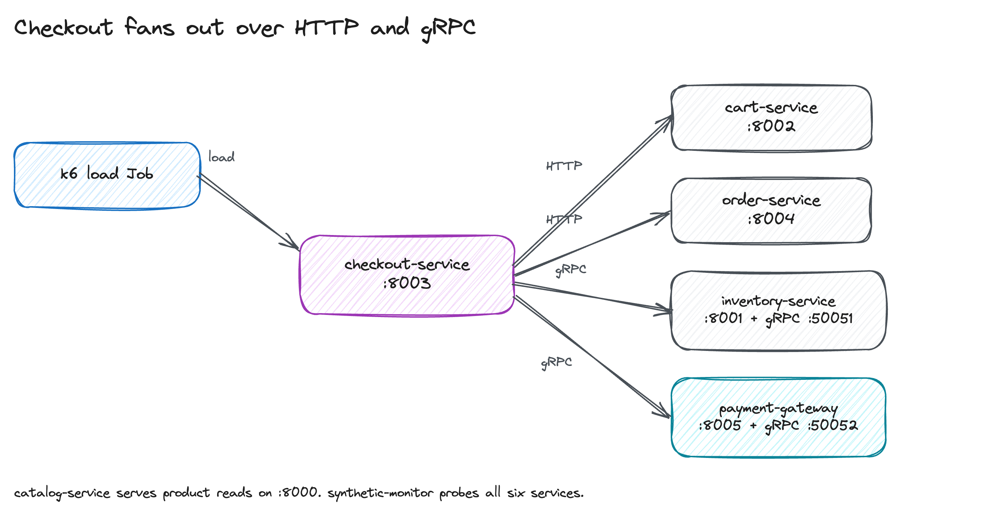
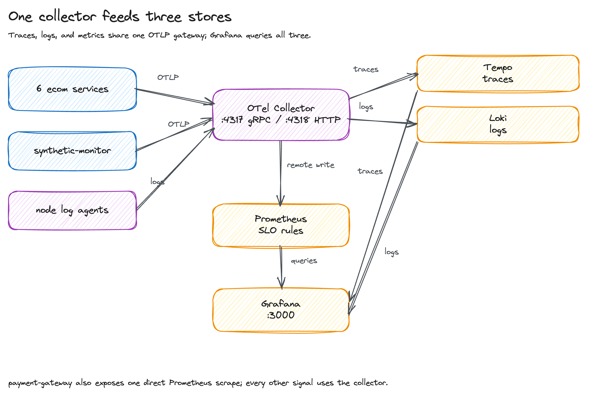
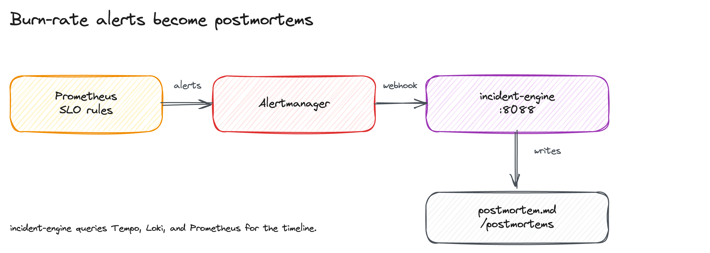

# Architecture

This document covers the request path, the telemetry path, and the alert path. It also lists service responsibilities, the signal schema, SLO strategy, and the chaos and load testing approach.

## Request path

Six product services serve the demo. k6 drives checkout, and checkout is the only orchestrator: it reads the cart over HTTP, reserves stock over gRPC, charges over gRPC, and writes the order over HTTP. A failed step triggers compensation in reverse order.

catalog-service serves product reads and is not on the checkout path. synthetic-monitor probes every product service and exports the availability series behind the `ServiceDown` alert.

## Telemetry path

Application services export OTLP to `otel-collector.observability:4317`. Node log agents tail container logs and send them to the same gateway. The gateway adds Kubernetes metadata and fans out:

- traces to Tempo
- logs to Loki
- metrics to Prometheus remote write

Grafana queries Tempo, Loki, and Prometheus. payment-gateway also exposes one direct Prometheus scrape. It is the only service without an OTLP metrics path, and the scrape stays bounded to that one deployment.

## Alert path

Prometheus evaluates the recording and alert rules every 30 seconds. Alertmanager groups by `alertname` and `service`, then posts the group to incident-engine. The engine queries Prometheus, Tempo, and Loki for context, writes a Markdown postmortem, and stores incident metadata in SQLite.

Chaos Mesh injects faults into the `ecom` namespace during the demo, so the alert path has a known cause to correlate.

## Service responsibilities

| Service | Language | Runtime | Responsibility |
|---------|----------|---------|----------------|
| catalog-service | Python | FastAPI :8000 | Product catalog: list, search, get, create products. SQLite backend. |
| inventory-service | Python | FastAPI :8001 + gRPC :50051 | Stock reservation and release. SQLite backend. |
| cart-service | Python | FastAPI :8002 | In-memory shopping cart. |
| checkout-service | Python | FastAPI :8003 | Saga orchestrator: cart, inventory, payment, order. Compensation on failure. |
| order-service | Python | FastAPI :8004 | Order persistence. SQLite backend. |
| payment-gateway | Go | Chi HTTP :8005 + gRPC :50052 | Mock payment charge/refund. In-memory store. |
| synthetic-monitor | Python | FastAPI :8000 | Probes all six application services in-cluster and exports the availability telemetry behind `ServiceDown` alerts. |
| incident-engine | Python | FastAPI :8088 | Receives Alertmanager webhooks and writes Markdown postmortems. |

## Inter-service protocols

- **HTTP/JSON**: browser-facing or simple calls.
  - `checkout-service` -> `cart-service`
  - `checkout-service` -> `order-service`
  - `catalog-service` health and product REST endpoints
- **gRPC**: service-internal high-fanout or saga steps.
  - `checkout-service` -> `inventory-service` (`ReserveStock`, `ReleaseStock`)
  - `checkout-service` -> `payment-gateway` (`Charge`, `Refund`)

OpenTelemetry context propagation works across both HTTP and gRPC, so a single trace follows a checkout request from k6 through checkout, inventory, payment, and order.

## Telemetry flow

1. Python services export traces and the canonical HTTP request-duration histogram through OTLP to `otel-collector.observability.svc:4317`.
2. Payment exports traces through OTLP and exposes the same histogram schema to Prometheus through the bounded direct-scrape exception.
3. One node log agent per schedulable node tails Kubernetes container logs and forwards them to the single local-demo Collector gateway.
4. Gateway processors add Kubernetes metadata and project resource attributes. The servicegraph connector receives both sides of each trace at that one state owner.
5. Exporters fan out signals:
   - Traces -> Tempo (`otlp/tempo`)
   - Container logs -> Loki (`otlphttp/loki`)
   - Metrics -> Prometheus remote-write (`prometheusremotewrite`)
6. Grafana queries Tempo, Loki, Prometheus, and Alertmanager through four provisioned datasources and ten provisioned dashboards.

The stable RED series is `http_server_request_duration_seconds_{bucket,count,sum}`.
Prometheus resource labels are `service_name` and `service_namespace`; HTTP
labels are `http_response_status_code` and the route template `http_route`.

## Alert flow

1. Prometheus evaluates recording rules and alert rules every 30 seconds.
2. When an SLO burn-rate threshold is breached, Prometheus sends the alert to Alertmanager.
3. Alertmanager groups alerts by `alertname` and `service`, then routes them to the `incident-engine` webhook.
4. The incident engine receives the webhook, queries Prometheus for the active alert and recent metrics, fetches related traces from Tempo, and assembles a timeline.
5. The engine writes a Markdown postmortem with summary, impact, timeline, root cause, resolution, and lessons learned.

## SLO strategy

SLOs live in `slo/*.yaml`. Each file defines SLIs, objectives, rolling windows, and error budgets. The build helper `scripts/build_prometheus_rules.py` turns those definitions into:

- Recording rules that compute ratios over `5m`, `30m`, `1h`, `6h`, `1d`, `3d`, and `30d`, plus service-qualified 30-day error-budget percentages.
- Multi-window multi-burn-rate (MWMB) alerts.

### Burn-rate tiers

| Tier | Windows | Severity | Action |
|------|---------|----------|--------|
| Fast burn | 1h and 6h | page | Error budget will be exhausted soon unless the failure stops. |
| Slow burn | 6h and 3d | warning | Budget is draining steadily; open a ticket. |
| Service down | 1m | page | The synthetic health check reports failure. |
| High error rate | 5m | page | More than 5% 5xx responses. |
| High latency | 5m | warning | p99 latency exceeded 2x the SLO threshold. |

### Default objectives

| Service | Availability | Latency p99 |
|---------|--------------|-------------|
| catalog-service | 99.95% | < 200 ms |
| inventory-service | 99.95% | < 150 ms |
| cart-service | 99.9% | < 100 ms |
| checkout-service | 99.9% | < 500 ms |
| order-service | 99.9% | < 300 ms |
| payment-gateway | 99.5% | < 1000 ms |
| end-to-end-checkout | 99% | < 2000 ms |

## Chaos and load testing

### Load testing

k6 scripts in `load/k6/` cover four profiles:

- **smoke**: 1 VU for 30s, validates every `/healthz` endpoint.
- **load**: ramp from 50 to 100 VUs, then drain; exercises the checkout flow.
- **stress**: ramp to 100 and then 200 VUs over ten minutes.
- **spike**: jump from 10 to 500 VUs, hold for 30 seconds, then recover.

Each profile runs as a Kubernetes Job in the `load` namespace and reaches the
`ecom` services through namespace-qualified ClusterIP DNS.

### Chaos testing

Chaos Mesh experiments in `chaos/experiments/`:

| Experiment | Target | Fault |
|------------|--------|-------|
| pod-kill-checkout | checkout-service | Container kill, one pod |
| network-delay-payment | payment-gateway | Latency injection |
| cpu-stress-catalog | catalog-service | CPU exhaustion |
| dns-chaos-inventory | inventory-service | DNS failure |

`make demo` starts load, applies a causal checkout PodChaos, waits for its correlated ServiceDown postmortem, then starts the recurring checkout workflow while the load remains active. It removes the workflow, PodChaos, workflow nodes, and load Job on every exit path.

## Related docs

- [RUNBOOK.md](./RUNBOOK.md): operational playbooks and cookbooks
- [DEMO.md](./DEMO.md): how to run and interpret the demo
- [SETUP.md](./SETUP.md): prerequisites and full setup
- [DRAWINGS.md](./DRAWINGS.md): architecture figure source and regeneration
