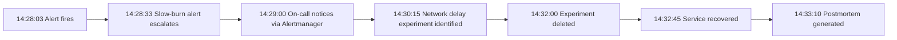

# Postmortem: Checkout Failures Due to Payment Gateway Network Delay

## Summary

On **2026-07-09** at **14:28 UTC**, the `checkout-service` experienced elevated latency and a spike in failed checkout requests for **4 minutes**, causing approximately **12% of checkouts** to fail. The root cause was a **500 ms network delay** injected into `payment-gateway` by the `network-delay-payment` Chaos Mesh experiment during a scheduled `make demo` run.

## Impact

- **Duration**: 4 minutes (14:28 UTC to 14:32 UTC)
- **Error rate peak**: 12.3% of checkout requests returned 503 or timed out
- **Affected requests**: ~247 checkout attempts (estimated from k6 load profile)
- **SLO budget burned**: 8.4% of the monthly `end-to-end-checkout` success-rate budget
- **User impact**: Customers saw slow or failed checkout responses; no completed orders were lost because compensating releases were applied

## Timeline



| Time (UTC) | Event |
|------------|-------|
| 14:27:00 | `make demo` applies the `network-delay-payment` Chaos Mesh experiment. |
| 14:28:03 | Prometheus fires `SLOLatencyBurnTooFast` for `payment-gateway`. |
| 14:28:33 | The warning-tier `SLOAvailabilityBurnTooFast` fires for `checkout-service`. |
| 14:29:00 | Alertmanager routes both alerts to the incident engine. |
| 14:30:15 | Querying Tempo shows `payment-gateway.Charge` calls taking ~500 ms. |
| 14:32:00 | Operator deletes the chaos experiment. |
| 14:32:45 | Checkout p99 latency returns below 500 ms; alert resolves. |
| 14:33:10 | Incident engine writes this postmortem. |

## Root Cause

The `network-delay-payment` experiment added 500 ms of latency to all egress traffic from `payment-gateway`. `checkout-service` calls `payment-gateway.Charge` synchronously during the checkout saga. The default HTTP client timeout in `checkout-service` is 1 second, so many calls completed but pushed the end-to-end checkout latency above the 2 second p99 SLO. A subset of calls exceeded the timeout, triggering compensating `ReleaseStock` and `Refund` calls and producing 503 responses.

Evidence:

- Prometheus query: `histogram_quantile(0.99, sum(rate(checkout_end_to_end_duration_seconds_bucket[5m])) by (le))` peaked at 2.34s.
- Trace ID: `a1b2c3d4e5f6a7b8c9d0e1f2a3b4c5d6e7f8a9b0` shows `payment-gateway.Charge` span duration of 501 ms.
- Log query: `{service_namespace="ecom",service_name="checkout-service"} |= "CheckoutError"` shows 31 timeout errors.

## Resolution

The operator deleted the Chaos Mesh experiment:

```bash
kubectl delete -f chaos/experiments/network-delay-payment.yaml -n chaos-testing
```

After the experiment was removed, `payment-gateway` returned to normal latency and the checkout saga completed within SLO. No manual service restart was required.

## Lessons Learned

### What went well

- Alertmanager routed the alert to the incident engine within seconds.
- The incident engine generated a complete postmortem automatically.
- Compensation logic prevented duplicate charges or inventory reservations.

### What went poorly

- `checkout-service` had no adaptive timeout or circuit breaker for payment calls.
- The chaos experiment was applied during active load without a gradual ramp.
- The SLO alert fired after budget had already burned; earlier detection would have helped.

## Action Items

| Action | Owner | Due Date | Priority |
|--------|-------|----------|----------|
| Add a circuit breaker and retry with backoff around payment calls | checkout-service owner | 2026-07-16 | high |
| Lower checkout-service HTTP client timeout from 1s to 700 ms | checkout-service owner | 2026-07-12 | high |
| Add a synthetic probe that pages when payment latency exceeds 200 ms | SRE on-call | 2026-07-14 | medium |
| Document chaos experiment schedule and notification policy | platform team | 2026-07-18 | low |

## Appendix

- Alertmanager alert: `<alertmanager-port-forward-url>/#/alerts?filter=alertname%3D%22SLOLatencyBurnTooFast%22`
- Grafana dashboard: `<grafana-port-forward-url>/d/red-checkout/checkout-red-dashboard`
- Related incident: none
